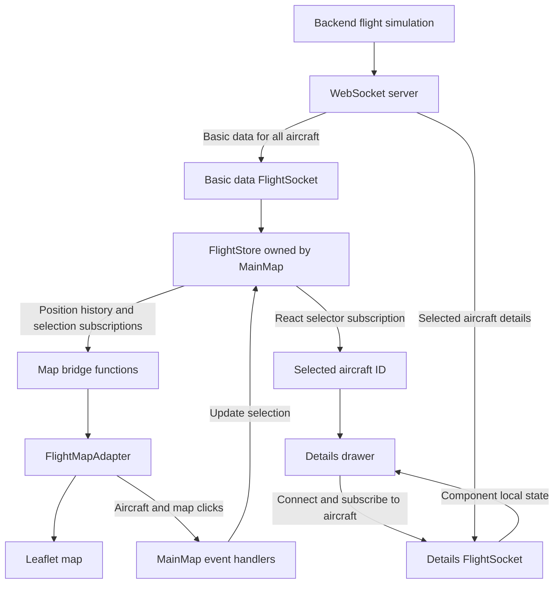

# Flight Hero

A real-time flight visualization application. The backend simulates flights and streams updates over WebSocket. The frontend displays aircraft positions and headings on a map, with recent flight trails and live details for the selected aircraft.

The project uses npm workspaces to manage the React frontend, Node.js backend, and shared TypeScript contracts.

## Quick Start

Use Node.js **18.20.x** or a newer version matching `package.json` (Node.js 22/24 is recommended for ongoing development). Node 18 compatibility is retained for the interview environment; Node 18 itself is end-of-life. With nvm, run `nvm install` and `nvm use` to select the tested version in `.nvmrc`.

> **Installation warnings:** To support the Node.js 18 environment specified in the interview task, the toolchain uses older compatible dependency versions. As a result, `npm install` and `npm ci` may report vulnerability warnings for development dependencies. These are known security advisories, not installation failures. See [Node 18 Toolchain Compatibility](#node-18-toolchain-compatibility) for details and limitations.

Run from the repository root:

```sh
npm install

cp packages/be/.env.example packages/be/.env
cp packages/fe/.env.example packages/fe/.env

npm run dev
```

Open [http://localhost:5173](http://localhost:5173). The backend listens on port `4000` by default.

The default configuration simulates 20 aircraft and pushes both basic and detailed data every second. Click an aircraft to view its details and recent trail. Closing the details drawer clears the selection.

### Configuration

| File               | Variable                      | Default                  | Description                                 |
| ------------------ | ----------------------------- | ------------------------ | ------------------------------------------- |
| `packages/be/.env` | `PORT`                        | `4000`                   | Backend port                                |
| `packages/be/.env` | `PLANES_COUNT`                | `20`                     | Number of simulated aircraft                |
| `packages/be/.env` | `BASIC_UPDATE_INTERVAL_MS`    | `1000`                   | Basic data push interval in milliseconds    |
| `packages/be/.env` | `DETAILED_UPDATE_INTERVAL_MS` | `1000`                   | Detailed data push interval in milliseconds |
| `packages/fe/.env` | `VITE_WS_BASE_URL`            | `ws://localhost:4000/ws` | Frontend WebSocket base URL                 |

If you change the backend port, update the frontend WebSocket URL accordingly.

### Commands

Run from the repository root:

```sh
npm run dev       # Start the frontend and backend together
npm run dev:be    # Start only the backend
npm run dev:fe    # Start only the frontend
npm run typecheck # Check TypeScript types across all workspaces
npm run build     # Build the frontend and backend
npm start         # Start the compiled backend
```

The backend build runs `packages/be/build.sh`: TypeScript compiles to `packages/be/dist/`, then the script copies its contents to the repository root’s `outputs/be/`, replacing the previous backend copy. `npm start` runs `packages/be/dist/index.js`. Frontend static files are built into `outputs/fe/`. Each build updates only its own output directory, preserving the other package’s artifacts.

To preview the frontend production build:

```sh
npm run preview -w @flight-hero/fe
```

The backend must also be running to provide live data.

## Project Structure

```text
packages/
├── be/
│   └── src/
│       ├── index.ts                   # Entry point and environment configuration
│       ├── server.ts                  # WebSocket server, routing, and connection cleanup
│       ├── websocket-handlers.ts      # Data streams, detail subscriptions, and heartbeat replies
│       ├── simulation.ts              # Simulated aircraft collection
│       └── plane.ts                   # Individual aircraft data and movement simulation
├── fe/
│   └── src/
│       ├── components/
│       │   ├── main-map.tsx           # Coordinates the store, map, and basic data connection
│       │   └── plane-detail-drawer.tsx # Details UI and its WebSocket connection
│       ├── modules/
│       │   ├── map-adapters/          # Map interface, events, and Leaflet implementation
│       │   ├── websocket/             # Connection lifecycle and flight message protocol
│       │   └── configs/               # Frontend connection configuration
│       ├── store/                     # Store factory and map subscription bridge functions
│       ├── maps/                      # Local GeoJSON map resources
│       ├── assets/                    # Aircraft icons
│       └── styles/
└── contract/
    └── src/index.ts                   # Shared data and message types
```

Main technologies:

- Frontend: React, TypeScript, and Vite.
- State management: Zustand vanilla store.
- Map rendering: Leaflet.
- Backend: Node.js and ws.
- Shared contracts: TypeScript types.

## Architecture



The backend updates the simulation every 100 milliseconds and exposes two WebSocket endpoints, each with a configurable push interval:

| Endpoint             | Behavior                                                                                                               |
| -------------------- | ---------------------------------------------------------------------------------------------------------------------- |
| `/ws/planes/basic`   | Sends basic data for all aircraft immediately after connection and at regular intervals                                |
| `/ws/planes/details` | After receiving `{ type: "subscribe", planeId }`, sends details for that aircraft immediately and at regular intervals |

The frontend stores basic aircraft information, recent position samples, and the selected aircraft ID in the store owned by the current map. Bridge functions derive current positions and trails from those samples and pass them to the map adapter. Detailed data is kept in the drawer's local component state because only the drawer uses it.

The shared `contract` package defines aircraft data and WebSocket message types to keep frontend and backend definitions aligned. It provides compile-time type checks, not full runtime payload validation.

## Design Decisions

### 1. Map Adapter: Isolating the Map Engine from Application Logic

Map SDKs have their own instances, markers, layers, and event models. Calling those APIs directly from components and state logic would spread map implementation details throughout the application.

`FlightMapAdapter` defines the capabilities the application needs:

- Initialize and destroy the map.
- Update or remove aircraft.
- Display or clear trails.
- Notify the application through `flightClick`, `mapClick`, and `mapLoaded` events.

`LeafletAdapter` implements this interface and owns the Leaflet instance, aircraft markers, trail layers, and map resources. Components and state bridge functions interact with the adapter interface without handling Leaflet objects directly.

This boundary allows map rendering to evolve independently and makes it possible to use a substitute adapter when testing application logic. Leaflet is the only implementation currently available; supporting another engine still requires implementing the interface and updating the factory configuration, while limiting changes to the application layer.

The adapter reuses markers by aircraft ID, updating their coordinates and headings instead of recreating them. The basemap uses local GeoJSON resources and requires no map service API key.

### 2. WebSocket: Separating Transport Management from the Flight Protocol

The WebSocket implementation has two layers:

| Layer              | Responsibility                                                                              |
| ------------------ | ------------------------------------------------------------------------------------------- |
| `SocketConnection` | Connection establishment, heartbeat, timeouts, reconnection, and resource cleanup           |
| `FlightSocket`     | Flight message JSON encoding and decoding, message type dispatch, and subscription messages |

The transport layer does not depend on aircraft data structures, and the flight protocol layer does not need to duplicate connection recovery logic.

#### Connection Recovery

The default connection timeout is 10 seconds. Once connected, the client waits 15 seconds before sending a text `ping`. If no `pong` arrives within 5 seconds, it releases the current connection and schedules a reconnect. Each `pong` schedules the next heartbeat so that only one heartbeat response is pending at a time.

Reconnection uses exponential backoff capped at 60 seconds, plus an additional 500–1000 milliseconds of random jitter to spread reconnect attempts across clients. A successful connection resets the retry counter.

An explicit `disconnect()` stops reconnection, clears timers and event listeners, and closes the socket. Close code `1008` also stops retries because an invalid path or subscription requires correcting the request.

#### Connection Ownership and Lifecycle

`MainMap` owns the basic data connection and starts it after the map emits `mapLoaded`, ensuring map resources are ready before position updates arrive. Unmounting the component destroys the map and disconnects the socket.

The details drawer owns its connection, which exists only while an aircraft's details are being viewed. Switching aircraft unmounts the previous drawer and closes its connection, then creates a new drawer and connection for the new selection. Closing the drawer also disconnects its socket.

The details subscription is sent on every `onOpen`, restoring the subscription after reconnection. The transport layer does not queue outgoing messages; the application layer explicitly restores its subscription.

The backend keeps a cleanup function for each connection, removing message listeners and clearing push timers when the connection closes or encounters an error.

### 3. Store and Map Decoupling: Independent State Instances and Explicit Subscriptions

The state layer uses Zustand's `createStore`. The `createFlightStore()` factory creates an independent vanilla store.

`MainMap` creates and owns its store through lazy initialization:

```ts
const [flightStore] = useState(() => createFlightStore());
```

The instance remains stable across component rerenders. Each `MainMap` owns its aircraft data and selection, preventing multiple map instances from sharing state and allowing tests to create isolated stores.

#### Separate Subscriptions for React and the Map

React uses `useStore(store, selector)` to subscribe to the selected aircraft ID and control the details drawer.

The map uses bridge functions to subscribe directly to the vanilla store:

- When position history changes, derive the latest positions and update aircraft markers and the selected aircraft's trail.
- When the selected ID changes, immediately switch or clear the trail without waiting for another position update.

Continuous position updates reach the map through store subscriptions, without requiring a React rerender of `MainMap` to drive map rendering.

#### State and Rendering Boundaries

```text
Basic data:  WebSocket → Store → Subscription bridge → Map adapter
Interaction: Map event → MainMap → Store → Map and React UI
```

Store actions update data, while the adapter manages map objects. Bridge functions receive the store and adapter instances, translate state changes into map operations, and return unsubscribe functions for component cleanup.

The bridge functions currently live in the same file as the store definition, but depend on the `FlightMapAdapter` interface. State update logic does not depend on the Leaflet implementation.

### 4. Single Source of Truth: Deriving the Current Position from History

The store retains the latest 300 position samples for each aircraft, without storing a separate copy of its current position.

To update an aircraft marker, the bridge takes the final sample in its position history as the current position and heading. To draw its trail, it uses the coordinates from the same sequence.

```text
WebSocket position update
        ↓
Latest 300 position samples
        ├── Final sample → Aircraft marker position and heading
        └── Coordinate sequence → Flight trail
```

Position history is the single source of truth for frontend position state; the current position is derived from it. Each incoming update maintains one state representation, avoiding synchronization issues between separately stored current positions and trails. This keeps the aircraft marker aligned with the end of its trail.

The 300-sample limit also bounds per-aircraft history memory usage and trail rendering costs. This is recent history collected by the frontend, rather than a complete flight history. “Latest position” means the most recently received sample.

## Automated Tests

The frontend uses **Vitest** for unit/integration tests, **React Testing Library** and **user-event** for component interactions, and **Playwright** for Chromium end-to-end tests.

```sh
npm test                 # Transport, protocol, store, component and real-server integration tests
npm run test:watch -w @flight-hero/fe
npm exec -w @flight-hero/fe -- playwright install chromium  # One-time browser installation
npm run test:e2e          # Starts isolated frontend + actual backend automatically
npm run typecheck        # Includes TypeScript checks for test code and test configurations
```

Unit tests use a controllable WebSocket boundary and fake timers to cover connection/heartbeat timeouts, exponential backoff, cleanup, protocol filtering and subscription recovery without waiting in real time. Store tests cover instance isolation, immutable history updates, the 300-sample limit, and selection/position synchronization with the map. Component tests exercise the real protocol and store, substituting only browser/third-party boundaries. The jsdom dialog shim is supplemented by native dialog interactions in Chromium.

A localhost integration test runs the actual backend and sends an invalid aircraft subscription through the production `FlightSocket`. The server's `{ type: "error", message: "..." }` frame is ignored by the flight protocol; its subsequent close code **1008 stops automatic retries**, without throwing an application exception. Separate fake-timer tests verify that transient close codes such as 1006/1011 reconnect, and restore the selected aircraft subscription. A permanently invalid ID is deliberately not retried indefinitely.

End-to-end tests use the real Leaflet map, React app, native browser WebSocket and simulated backend. They cover live markers, details and trail display, closing with the button/Escape, switching aircraft and ongoing marker movement. They reserve frontend port **4173** and backend port **4400**, override local environment values, and refuse to reuse an existing server so tests cannot silently run against unrelated data. Failures retain Playwright traces under the ignored `packages/fe/test-results/` directory.

### Workspace Test Dependencies

Frontend integration tests import `createServer` from `@flight-hero/be/server` and `Simulation` from `@flight-hero/be/simulation`. The private backend package explicitly exports these two TypeScript source modules, so Vitest can run them without a backend build. These entry points require TypeScript-aware tooling; they do not import the application startup module. The backend still starts with its existing `dev` and `start` commands.

The frontend declares the backend as a development dependency because only tests use it. Both frontend and backend declare `@flight-hero/contract` as a development dependency because all current imports are type-only and disappear from emitted JavaScript. If the contract later provides runtime values, consumers using those values should move it to runtime dependencies.

### Node 18 Toolchain Compatibility

To retain compatibility with the Node.js 18 environment specified in the interview task, the build and test tools are pinned to Node 18-compatible releases: Vite 6, React plugin 4, Vitest 3, jsdom 26, Playwright 1.56 and jest-dom 6. React application code and shared contracts are unchanged by this compatibility choice.

Some older development dependencies have known security advisories without Node 18-compatible fixes. Run `npm audit` to inspect the current lockfile. Use the test runner only with trusted repository tests and configuration, and do not expose Vitest's API/UI server to a network. These development tools are not included in the browser production bundle. This compatibility setup is intended for the local interview exercise; upgrade the toolchain and Node.js before adopting it for ongoing production development.
